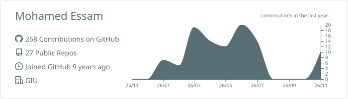
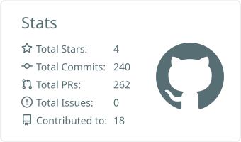
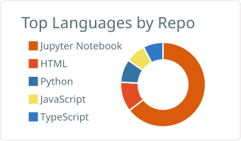
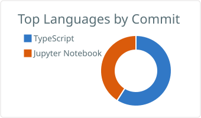

<h1 align="center">Hi, I'm Mohamed Essam 👋</h1>

  <b>Lead Software Engineer · AI Engineer · Autonomous Vehicles Researcher</b> 
  Berlin, Germany · I build scalable backend systems and put LLMs, vision and speech models into production.

  
  
  
  

---

## 🧭 About Me

-  **Backend Lead at Soft Blue Ocean**: payments, payroll and salary-advance platforms, plus LLM-powered products
-  Work daily with **OpenAI GPT, Anthropic Claude and Google Gemini**, and fine-tune **LLMs and Vision-Language Models**
-  Research in **autonomous vehicles**: pedestrian crossing-intention prediction from a self-collected Cairo dataset
-  **Master's in Data Science**, German International University (GIU), including a research semester at GIU Berlin
-  Taught Software Engineering, MERN, NestJS and Next.js at GIU; former **CS50 (Harvard) staff member** and CS50 Arabic lecturer
-  Arabic (native) · English (professional) · German 

---

## 💼 Experience

**Soft Blue Ocean** · Backend Lead / Senior Software Engineer · *Oct 2025 – present*
- **KhidmaMart — Home Services Marketplace:** Led backend and AI development for a scalable, Arabic-first platform connecting customers with service providers and companies across Egypt. Designed and implemented core systems including service requests, competitive bidding, smart booking, provider matching, company service carts, payment workflows, real-time tracking, and service-zone management. Developed AI-powered Smart Booking using multimodal LLMs to analyze customer descriptions and images, identify service categories, suggest relevant services, and generate follow-up questions to better understand customer needs. Built REST APIs, database architecture, role-based access, and integrations supporting client, provider, company, and admin workflows.

- **Aqar Chat — AI Real Estate Assistant:** Led development of an LLM-powered WhatsApp assistant integrating RAG, semantic search, and property recommendations to understand customer preferences, retrieve relevant listings, and automate meeting bookings with real estate agents.

- **Rawatb — Payroll & Salary Advance Platform:** Built scalable financial backends supporting salary advances, payroll processing, multi-gateway payments, automated reconciliation, and **Wafeq** accounting integration.

- **MaaQraah — AI Quran Learning Platform:** Contributed to platform development and AI-powered learning workflows supporting Quran education, recitation assessment, and online sessions.

**Core Technologies:** Node.js, TypeScript, Python, PostgreSQL, Redis, REST APIs, WebSockets, LLMs, Multimodal AI, AI Agents, RAG, Vector Search, Recommendation Systems, Docker, AWS.

**Medkaa** · Senior Full-Stack Engineer · *May 2026 – Oct 2026*
- Full-stack work on a healthcare recruitment platform connecting doctors, nurses and pharmacists with hospitals and clinics

**German International University (Cairo & Berlin)** · Research Assistant · *Sep 2022 – Jul 2026*
- Computer vision for autonomous vehicles; pedestrian intention prediction with LSTMs, ensembles and VLMs
- Taught Software Engineering, Image Processing and Computer Vision; supervised student projects and theses

**DropMe** · Senior Software Engineer · *May 2025 – Oct 2025*
- Led frontend, backend and AI for recycling machines connected to the cloud: real-time data, dashboards, rewards, and material-classification models

**US-based AI company (NDA)** · Software Engineer · *Apr 2024 – Apr 2025*
- Full-stack AI platform with Next.js, NestJS and prompt-engineered AI interactions

**Pseudocode Software Solutions** · Software Engineer · *Mar 2022 – Feb 2024*
- Python/Django web applications and APIs, delivered remotely

*Earlier: Udacity session lead, AI instructor at Creativa Hub, speech-recognition research assistant at Modern Academy, and Python/AI engineering roles.*

---

## 🛠️ Tech Stack

**Backend:**

**AI / ML:**

&nbsp;LLMs (GPT, Claude, Gemini) · VLM fine-tuning (Qwen2-VL) · YOLOv8 · LangChain

**Frontend & Mobile:**

**Cloud & Tools:**

---

## 🚀 Projects

### 🌐 Production Products (live, closed-source)

| Product | What it is | My role |
|---|---|---|
| [**KhidmaMart**](https://khidmamart.com/) | Arabic-first marketplace connecting customers across Egypt with verified service providers: request, compare offers, book, pay securely and track in real time | Soft Blue Ocean |
| [**Aqar Chat**](https://aqar-chat.com/) | AI real-estate assistant on WhatsApp (Meta Business API) that uses Gemini and GPT to understand client needs, recommend properties, qualify leads and book viewings with brokers | Led the build at Soft Blue Ocean |
| [**MaaQraah**](https://www.maaqraah.com/) | AI Quran-learning platform: speech-to-text recitation analysis, personalised feedback, auto-generated tests and live Zoom classes | Backend architecture, AI recitation assessment, Zoom integration, deployment |
| [**Rawatb**](https://rawatb.io/) | Salary-in-advance platform in Saudi Arabia that lets employees access earned wages before payday | Backend: payment gateways, automated reconciliation, Wafeq accounting integration |
| [**Medkaa**](https://medkaa.com/login) | Healthcare recruitment platform connecting doctors, nurses and pharmacists with hospitals and clinics | Senior full-stack engineer |

### 🚗 Open Source: AI & Autonomous Systems

| Project | Highlights |
|---|---|
| [**Pedestrian Crossing Intention, from a Taxi Driver's Perspective**](https://github.com/mohamedessamcs96/Which-Pedestrians-Are-Likely-to-Cross-Without-Stopping-A-Taxi-Driver-Perspective) | Master's research. Self-recorded Cairo street dataset annotated in CVAT; compares a voting ensemble (83.3% acc), RoBERTa embeddings and GPT-4o Vision, plus an LSTM action classifier (86.2%) and Qwen2-VL fine-tuning |
| [**Waqood Amen: Smart Gas Station Monitoring**](https://github.com/mohamedessamcs96/Waqood-Amen) | YOLOv8 vehicle and plate detection, Arabic/English KSA plate OCR (PaddleOCR + EasyOCR), car colour detection, payment tracking; Django + React, Dockerised |
| [**Autonomous Car Lane & Speed Optimisation**](https://github.com/mohamedessamcs96/Constraint-Programming-Autonomous-Car-Lane-Speed-Optimization) | Constraint programming with Google OR-Tools, visualised in a real-time Tkinter simulation |

### 🏗️ Open Source: Backend & Distributed Systems

| Project | Highlights |
|---|---|
| [**LightPOS: Restaurant Management System**](https://github.com/mohamedessamcs96/Leitex) | Django REST + Django Channels WebSockets for real-time orders, React/TypeScript frontend |
| [**NextBike: Real-Time Bike Tracking**](https://github.com/mohamedessamcs96/Real-time-bike-tracker-using-kafka) | NestJS + Apache Kafka + WebSockets; live GPS events stream to a React map with zero polling |
| [**Uber Eats Simulation: CQRS vs Blocking**](https://github.com/mohamedessamcs96/Simulating-Uber-Eats-using-Kafka-and-CQRS) | NestJS demo comparing CQRS + Kafka async architecture with a traditional synchronous design |
| [**Reading Recommendation API**](https://github.com/mohamedessamcs96/Reading-Recommendation-API) | NestJS + Prisma + JWT role-based auth, Dockerised |

📚 Also: [Teaching & workshops](https://github.com/mohamedessamcs96/teaching-and-workshops), course labs and workshop material from GIU, ECCAT, Creativa Hub and CS50 Arabic.

---

## 🏆 Highlights

- CS50 (Harvard) staff member; taught and managed **CS50 in Arabic** across Egyptian universities (2016–2018)
- Speaker at **GDG Ismailia** (starting a programming career) and **Eccatronix**, Egyptian Chinese College for Applied Technology
- **Google Solution Challenge**, American University in Cairo

## 📺 Talks & Sessions

<table>
  <tr>
    <td align="center" width="50%"> <b>Machine Learning 101</b></td>
    <td align="center" width="50%"> <b>Data Science Concepts (playlist)</b></td>
  </tr>
  <tr>
    <td align="center" width="50%"> <b>AI in Robotics (playlist)</b></td>
    <td align="center" width="50%"> <b>Machine Learning Workshop by ECCAT (playlist)</b></td>
  </tr>
</table>

---

## 📊 GitHub Stats

  <picture><source media="(prefers-color-scheme: dark)" srcset="https://raw.githubusercontent.com/mohamedessamcs96/mohamedessamcs96/master/profile-summary-card-output/github_dark/0-profile-details.svg"></picture>

  <picture><source media="(prefers-color-scheme: dark)" srcset="https://raw.githubusercontent.com/mohamedessamcs96/mohamedessamcs96/master/profile-summary-card-output/github_dark/3-stats.svg"></picture>
  <picture><source media="(prefers-color-scheme: dark)" srcset="https://raw.githubusercontent.com/mohamedessamcs96/mohamedessamcs96/master/profile-summary-card-output/github_dark/1-repos-per-language.svg"></picture>
  <picture><source media="(prefers-color-scheme: dark)" srcset="https://raw.githubusercontent.com/mohamedessamcs96/mohamedessamcs96/master/profile-summary-card-output/github_dark/2-most-commit-language.svg"></picture>

<i>Open to roles and collaborations in backend engineering, applied AI and autonomous systems. Feel free to reach out.</i>

